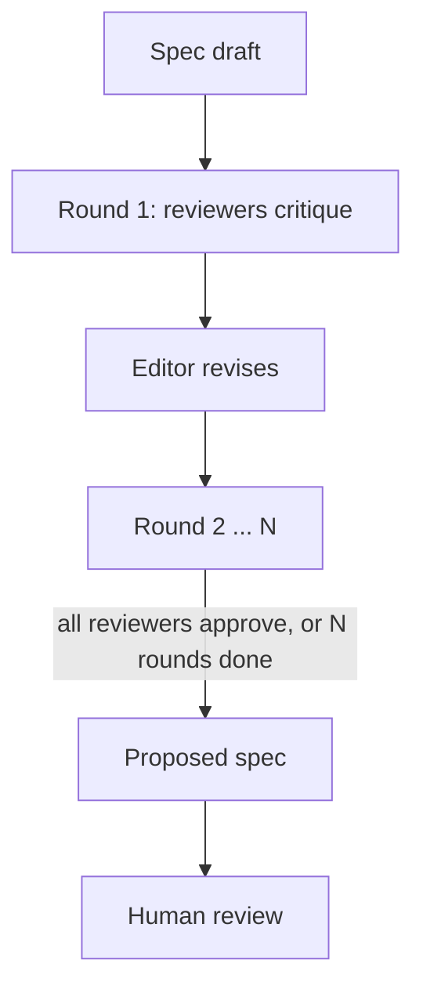

# spec-council

Multi-agent review of technical specifications. Several LLM reviewers, each with a role you define, review a spec over several rounds. An editor model revises the spec after each round. The output is a **proposed spec**, not a final one: a person reviews it and decides what to accept.



## Why

Spec reviews are slow, and weak spots often show up late, once engineering has started. One model reviewing a spec misses things. Several models with different roles disagree with each other, and that disagreement surfaces gaps, vague requirements and edge cases early. People still make the final call.

## Features

- **Configurable roles.** Reviewers are defined in a TOML file: name, role in plain words, provider and model. Add or remove reviewers freely.
- **Several providers.** Anthropic, OpenAI and Gemini, mixed in one council. Plain HTTP, no SDKs, no runtime dependencies.
- **Multiple rounds.** Default is 7. Stops early when every reviewer approves.
- **Full trail.** Each round writes its reviews and the revised spec to its own folder, so you can see how the spec changed and why.
- **Offline mode.** A mock provider runs the whole flow without API keys, for demos and tests.

## Quick start

```bash
git clone https://github.com/cofson/spec-council
cd spec-council
pip install -e .

# Offline demo, no API keys
spec-council review examples/rate-limiter-spec.md --config examples/agents.mock.toml
```

With real models:

```bash
export ANTHROPIC_API_KEY=...
export OPENAI_API_KEY=...
export GEMINI_API_KEY=...
spec-council review path/to/your-spec.md --config examples/agents.toml --rounds 7
```

Output:

```
runs/20261126-221500/
  00_input_spec.md
  round_01/reviews.md   round_01/spec.md
  round_02/...
  proposed_spec.md      <- marked "PROPOSED SPEC: not final"
```

## Config

```toml
[run]
rounds = 7
stop_on_consensus = true

[[agents]]
name = "Security reviewer"
role = "Find security, privacy and abuse risks. Think like an attacker."
provider = "anthropic"
model = "claude-sonnet-4-5"

[[agents]]
name = "Implementer"
role = "Check that an engineer could build this without guessing."
provider = "openai"
model = "gpt-4o"

[editor]
provider = "anthropic"
model = "claude-sonnet-4-5"
```

Model names change often. Use the ones your accounts have access to.

## How a round works

1. Every reviewer reads the current spec and answers with `VERDICT: APPROVE` or `VERDICT: REVISE`, followed by concrete issues.
2. If everyone approves, the run stops (unless `stop_on_consensus = false`).
3. Otherwise the editor gets the spec plus all reviews and returns a revised spec.

## Tests

```bash
pip install -e ".[dev]"
pytest
```

## Credits

Inspired by [adversarial-spec](https://github.com/zscole/adversarial-spec) by zscole, a Claude Code plugin where several LLMs debate a spec until they agree. spec-council is an independent implementation: a standalone CLI with configurable reviewer roles, a separate editor step, per-round output and a proposed spec that always goes to human review.

## License

MIT
